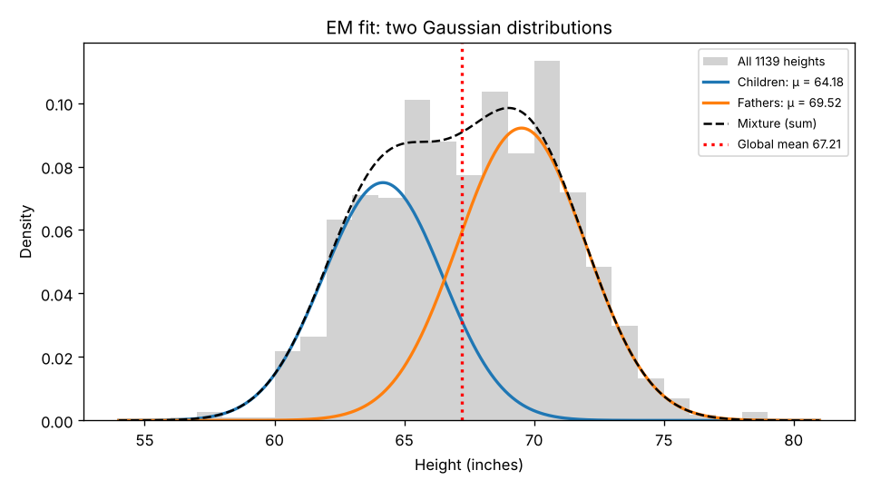
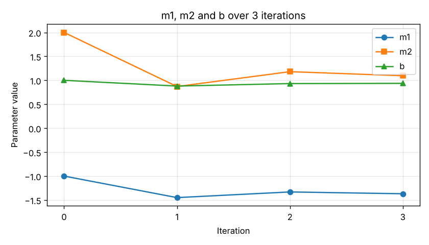
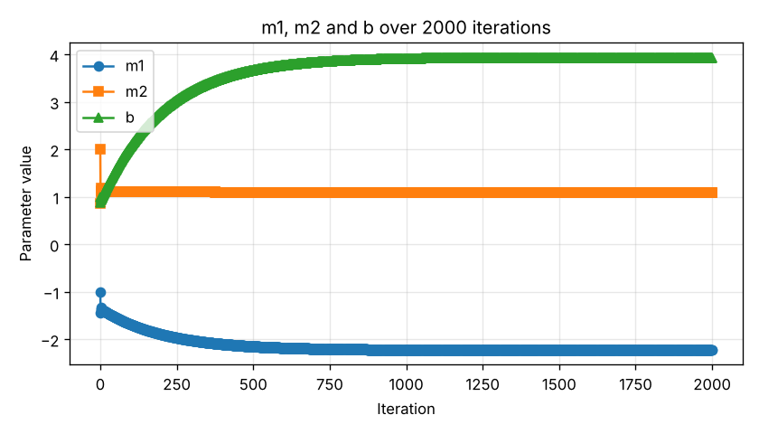
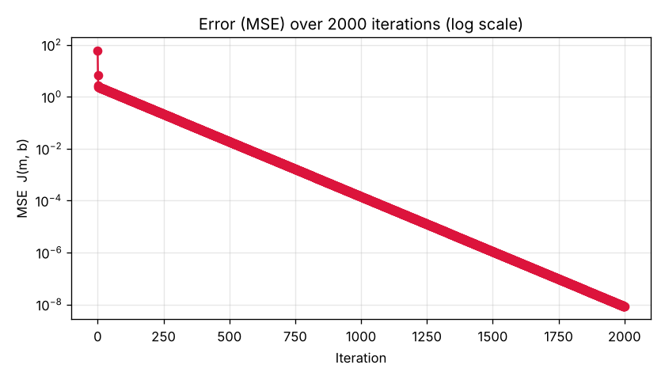

# Formative 3 - Probability Distributions, Bayesian Probability, and Gradient Descent Implementation

**Assignment:** Formative 3 - Probability Distributions, Bayesian Probability, and Gradient Descent Implementation  
**Cohort:** Cohort 2  
**Team:** Group 20  
**Repository:** [Abdull-Kudus/ML--Formative--3-Group-20](https://github.com/Abdull-Kudus/ML--Formative--3-Group-20)  

---

## Team

| Member | Role | Responsible for | Notebook & Commits | Part 3 Manual Calculation |
|---|---|---|---|---|
| **Abdul Kudus Zakaria Mukhtaru** | Team Lead | Project management, Git branch oversight, code review, mathematical validation, documentation | `notebooks/Part4_Gradient_Descent_in_Code.ipynb` | Setup, Chain Rule derivation, Iteration 1, Summary and Trend |
| **Nitonde Binthia** | Member | Sentiment analysis, text preprocessing, Bayesian conditional probability modeling | `notebooks/Part2_Bayesian_Probability_IMDb_Reviews.ipynb` | Iteration 2 |
| **Bior Majok Aguer Kuir** | Member | Gaussian mixture modeling, EM algorithm implementation, distribution visualization | `notebooks/Part1_Probability_Distributions_EM_Algorithm.ipynb` | Iteration 3 |

---

## Repository Layout

```
ML--Formative--3-Group-20/
├── README.md                                                     # Master presentation and grading documentation
├── requirements.txt                                              # Environment dependencies (SciPy >= 1.15, NumPy, Pandas, Matplotlib)
├── .gitignore                                                    # Clean repo exclusions (.venv, caches, raw CSVs)
├── data/
│   ├── GaltonFamilies.csv                                        # Part 1: Galton height dataset (934 children, 205 unique fathers)
│   └── IMDB_Dataset.csv.gz                                       # Part 2: IMDb 50,000 movie reviews (compressed for repository storage)
├── docs/
│   ├── Part3_Gradient_Descent_Manual_Calculation_Handwritten.pdf # Part 3: Graded neat handwritten manual derivation (5 pages)
│   └── Task Sheet_Formative3_Assignment name_Cohort 2_Team20 - 1.pdf # Official contribution and task tracking sheet
├── images/
│   ├── part1_em_fit.png                                          # Part 1: Final fitted Gaussian distributions vs empirical data
│   ├── part1_em_log_likelihood.png                               # Part 1: Log-likelihood convergence curve over 309 iterations
│   ├── part1_em_posterior.png                                    # Part 1: Posterior responsibility curves P(Children|x) vs P(Fathers|x)
│   ├── part4_gd_parameters.png                                   # Part 4: Parameter trajectory across 3 iterations
│   ├── part4_gd_error.png                                        # Part 4: MSE Cost J drop across 3 iterations
│   ├── part4_gd_parameters_2000.png                              # Part 4: Long-run parameter convergence (2000 iterations)
│   └── part4_gd_error_2000.png                                   # Part 4: Long-run MSE Cost J convergence to zero
└── notebooks/
    ├── Part1_Probability_Distributions_EM_Algorithm.ipynb        # Part 1 executable notebook (EM from scratch)
    ├── Part2_Bayesian_Probability_IMDb_Reviews.ipynb             # Part 2 executable notebook (Bayes theorem in basic Python)
    └── Part4_Gradient_Descent_in_Code.ipynb                      # Part 4 executable notebook (SciPy derivatives and GD loop)
```

---

## How to Run

### Local Environment
```bash
# 1. Clone repository
git clone https://github.com/Abdull-Kudus/ML--Formative--3-Group-20.git
cd ML--Formative--3-Group-20

# 2. Create and activate virtual environment
python -m venv .venv
# Windows:
.venv\Scripts\activate
# Linux/macOS:
source .venv/bin/activate

# 3. Install required dependencies
pip install -r requirements.txt

# 4. Launch Jupyter Notebook
jupyter notebook
```

### Google Colab Execution
Each Jupyter notebook contains automated setup cells at the top that clone this GitHub repository into Google Colab, set paths, and ensure reproducible execution without manual file uploading.

---

## Part 1 - Probability Distributions: EM Algorithm (Mixture of Two Gaussians)

**Notebook:** `notebooks/Part1_Probability_Distributions_EM_Algorithm.ipynb`  
**Dataset:** `data/GaltonFamilies.csv`  

### 1. Setup and Population Choice
- We selected **Fathers and Children** from the Galton dataset.
- In the raw dataset, father heights are repeated across all children in the same family. We extracted each father exactly once per family (205 unique fathers) and combined them with the 934 children, giving **1,139 total height measurements**.
- Ground-truth labels are hidden from the model. The data is treated as an unknown mixture of two Gaussian distributions:  
  `p(x) = π₁·N(x | μ₁, σ₁²) + π₂·N(x | μ₂, σ₂²)`  
  where `π₁ + π₂ = 1`. Component 1 corresponds to Children and Component 2 corresponds to Fathers (representing the template's "Pros/Basketball Player" group).

### 2. Algorithmic Steps (EM from Scratch)
1. **Initialization:** Split the dataset at the global mean (`67.21 in`). Observations below the mean give initial parameters for Component 1, and observations at or above give Component 2.
2. **Expectation Step (E-step):** For each observation `xᵢ`, compute the posterior responsibility `rᵢₖ` using Bayes' rule:  
   `rᵢₖ = πₖ·N(xᵢ | μₖ, σₖ²) / [ π₁·N(xᵢ | μ₁, σ₁²) + π₂·N(xᵢ | μ₂, σ₂²) ]`
3. **Maximization Step (M-step):** Update parameters using responsibility-weighted averages:  
   `Nₖ = Σᵢ rᵢₖ`  
   `μₖ = (1 / Nₖ) Σᵢ rᵢₖ xᵢ`  
   `σₖ² = (1 / Nₖ) Σᵢ rᵢₖ (xᵢ - μₖ)²`  
   `πₖ = Nₖ / N`
4. **Stopping Criterion:** Stop when the log-likelihood improvement `Δ ln L < 10⁻⁶`. The model converged after **309 iterations**.

### 3. Step-by-Step Optimization Tracking Table

| Iteration | μ1 (Children) | μ2 (Fathers) | σ1² | σ2² | π1 | π2 | Log-Likelihood |
|---|---|---|---|---|---|---|---|
| **0 (Initialization)** | 64.2598 | 70.2147 | 4.1428 | 3.5711 | 0.5048 | 0.4952 | -3071.1165 |
| **1** | 64.3784 | 70.0758 | 4.9168 | 4.2979 | 0.5033 | 0.4967 | -3053.5777 |
| **2** | 64.4368 | 69.9988 | 5.3058 | 4.6724 | 0.5017 | 0.4983 | -3049.7088 |
| **309 (Final Converged)** | **64.1772** | **69.5186** | **5.3024** | **6.0410** | **0.4325** | **0.5675** | **-3046.9895** |

### 4. Should You Simply Draw a Line at the Global Mean and Average Each Pile?
**Answer: No. A hard cut at the global mean is statistically inappropriate for five reasons:**
1. **High Misclassification in Overlapping Regions:** The height distributions overlap substantially. A hard boundary at `67.21 in` misclassifies **44 of 205 fathers (21.5%)** as children and **403 of 934 children (43.1%)** as fathers. No single line can separate overlapping continuous distributions without significant error.
2. **Severely Biased Variance Estimates:** Cutting at the mean forcibly truncates the tails of both distributions. The resulting piles appear artificially narrow (standard deviations of `2.04 in` and `1.89 in`) compared to the true variances identified by EM (`2.30 in` and `2.46 in`).
3. **The Global Mean Is the Wrong Boundary:** The global mean is sensitive to class proportions (934 vs 205). The true equiprobable decision boundary where `P(Children | x) = P(Fathers | x) = 0.5` is **`66.54 in`**, not `67.21 in`.
4. **Discards Classification Uncertainty:** Under a hard split, an individual of height `66.71 in` is assigned 100% to Children. EM assigns `P(Children) = 46.1%` and `P(Fathers) = 53.9%`, correctly reflecting genuine ambiguity.
5. **No Optimization:** Splitting at the mean is a static one-step heuristic. EM starts from that heuristic and iteratively increases the data log-likelihood from `-3071.12` to `-3046.99`.

### 5. What EM Discovered in the Data
When inspecting the fitted components against hidden ground truth:
- The **Children component** is 92% children (predominantly daughters).
- The **Fathers component** contains 81% of fathers and most adult sons. Because Galton measured adult children, sons (mean `69.2 in`) share nearly identical height distributions with fathers (mean `69.3 in`).

### 6. Live Test-Height Classification Demonstration
During presentations, coaches provide a random test height. The final cell of the Part 1 notebook outputs exact posterior probabilities:
- Input `62.0 in` -> `P(Children) = 0.9984,  P(Fathers) = 0.0016`
- Input `66.54 in` -> `P(Children) = 0.5000,  P(Fathers) = 0.5000` (Equiprobable boundary)
- Input `70.0 in` -> `P(Children) = 0.0328,  P(Fathers) = 0.9672`
- Input `74.0 in` -> `P(Children) = 0.0001,  P(Fathers) = 0.9999`



---

## Part 2 - Bayesian Probability: Sentiment Analysis on IMDb Movie Reviews

**Notebook:** `notebooks/Part2_Bayesian_Probability_IMDb_Reviews.ipynb`  
**Dataset:** `data/IMDB_Dataset.csv.gz` (50,000 reviews: 25,000 positive, 25,000 negative)  

### 1. Direction Choice and Scope
- **Direction Selected:** Our group exclusively computes **`P(Positive | keyword)`** for all keywords. (Computing one direction satisfies the rubric constraint).
- **Interpretation of Negative Words:** For negative keywords, a strong negative signal corresponds to an extremely low posterior `P(Positive | keyword) << 0.50`, directly yielding `P(Negative | keyword) = 1 - P(Positive | keyword) > 0.90`.
- **Pure Python Implementation:** Built strictly with Python standard library modules (`csv`, `gzip`, `string`). Zero external ML or NLP packages. Reviews are tokenized by lowercasing, removing punctuation, and stripping HTML linebreaks (`<br />`).

### 2. Bayes' Theorem Formula
`P(Positive | keyword) = [ P(keyword | Positive) × P(Positive) ] / P(keyword)`

- **Prior P(Positive):** `25,000 / 50,000 = 0.5000` (balanced dataset).
- **Likelihood P(kw | Positive):** `(Positive reviews containing keyword) / 25,000`.
- **Marginal P(kw):** `(All reviews containing keyword) / 50,000`.

### 3. Probability Tables

#### Positive Keywords (3 Selected)
| Keyword | Prior P(Pos) | Likelihood P(kw\|Pos) | Marginal P(kw) | Posterior P(Pos\|kw) | Direct Count Verification |
|---|---|---|---|---|---|
| **excellent** | 0.5000 | 2868 / 25000 = 0.1147 | 3552 / 50000 = 0.0710 | **0.8074** | 2868 / 3552 = 0.8074 |
| **wonderful** | 0.5000 | 2258 / 25000 = 0.0903 | 2780 / 50000 = 0.0556 | **0.8122** | 2258 / 2780 = 0.8122 |
| **superb** | 0.5000 | 1026 / 25000 = 0.0410 | 1199 / 50000 = 0.0240 | **0.8557** | 1026 / 1199 = 0.8557 |

#### Negative Keywords (3 Selected)
| Keyword | Prior P(Pos) | Likelihood P(kw\|Pos) | Marginal P(kw) | Posterior P(Pos\|kw) | Equivalent P(Neg\|kw) |
|---|---|---|---|---|---|
| **worst** | 0.5000 | 411 / 25000 = 0.0164 | 4434 / 50000 = 0.0887 | **0.0927** | **0.9073** (4023 / 4434) |
| **waste** | 0.5000 | 175 / 25000 = 0.0070 | 2534 / 50000 = 0.0507 | **0.0691** | **0.9309** (2359 / 2534) |
| **awful** | 0.5000 | 284 / 25000 = 0.0114 | 2882 / 50000 = 0.0576 | **0.0985** | **0.9015** (2598 / 2882) |

### 4. Technical Justification of Keyword Choices
- **Why Selected:** Each chosen positive word increases posterior probability from the 0.50 baseline to above 0.80. Each chosen negative word drops posterior probability below 0.10 (> 90% negative). Every selected keyword has high empirical support (1,199 to 4,434 reviews), ensuring statistical significance.
- **Why Other Keywords Were Rejected:**
  - *great* (Posterior 0.6741): Too diluted; appears in 4,099 negative reviews (e.g., "had great potential, but failed").
  - *bad* (Posterior 0.2511): Frequent in positive reviews describing villainy ("a great bad guy", "not bad").
  - *masterpiece* (Posterior 0.7274): Reviewers often use it to contrast ("this is definitely not a masterpiece").
  - *boring* (Posterior 0.1940): Weaker negative discriminator than *waste* (0.0691) and *worst* (0.0927).

---

## Part 3 - Gradient Descent Manual Calculation (Handwritten)

**Handwritten Document:** `docs/Part3_Gradient_Descent_Manual_Calculation_Handwritten.pdf`  

### 1. Problem Formulation
- **Linear Model in Matrix Form:**  
  `ŷ = Xm + b`  
  where:  
  `X = [[1, 3], [4, 10]],  y = [5, 6]ᵀ,  initial m = [-1, 2]ᵀ,  initial b = 1`
- **Mean Squared Error (MSE) Cost:**  
  `J(m, b) = (1/n) Σ (ŷᵢ - yᵢ)² = (1/n) eᵀe,  (n = 2)`
- **Learning Rate:** `α = 0.01` (stable because maximum eigenvalue `λ_max(XᵀX) ≈ 127.5 -> α < 2/127.5 ≈ 0.0157`).

### 2. Explicit Chain Rule Derivation
- Gradient with respect to weight vector `m`:  
  `∂J/∂m = (∂J/∂ŷ) · (∂ŷ/∂m) = (2/n) Xᵀ(ŷ - y)`
- Gradient with respect to bias `b`:  
  `∂J/∂b = (∂J/∂ŷ) · (∂ŷ/∂b) = (2/n) Σ(ŷᵢ - yᵢ) = (2/n) 1ᵀ(ŷ - y)`
- Update equations:  
  `m(new) = m(old) - α × (∂J/∂m)`  
  `b(new) = b(old) - α × (∂J/∂b)`

### 3. Step-by-Step Manual Iteration Results
Three full updates were completed by hand, with each member executing at least one full iteration:
- **Pages 1-2 (Abdul Kudus):** Setup, Chain Rule derivation, Iteration 1
- **Page 3 (Nitonde Binthia):** Iteration 2
- **Page 4 (Bior Aguer Kuir):** Iteration 3
- **Page 5 (Abdul Kudus):** Summary table and mathematical trend analysis

| Iteration | Member | m Start | b Start | ŷ = Xm + b | Error (ŷ - y) | Cost J | ∂J/∂m | ∂J/∂b | Updated m | Updated b |
|---|---|---|---|---|---|---|---|---|---|---|
| **1** | **Kudus** | `[-1, 2]ᵀ` | 1.0000 | `[6, 17]ᵀ` | `[1, 11]ᵀ` | **61.0000** | `[45, 113]ᵀ` | 12.0000 | `[-1.45, 0.87]ᵀ` | 0.8800 |
| **2** | **Binthia** | `[-1.45, 0.87]ᵀ` | 0.8800 | `[2.04, 3.78]ᵀ` | `[-2.96, -2.22]ᵀ` | **6.8450** | `[-11.84, -31.08]ᵀ` | -5.1800 | `[-1.3316, 1.1808]ᵀ` | 0.9318 |
| **3** | **Bior** | `[-1.3316, 1.1808]ᵀ` | 0.9318 | `[3.1424, 6.1996]ᵀ` | `[-1.8576, 0.1996]ᵀ` | **2.7238** | `[3.7962, 8.5618]ᵀ` | -0.4440 | `[-1.369562, 1.095182]ᵀ` | 0.93624 |

**State entering Iteration 4:**  
`ŷ = [2.852224, 6.409812]ᵀ,  e = [-2.147776, 0.409812]ᵀ,  J = 2.390444`

### 4. Trend Analysis
- **Monotonic Cost Reduction:** Cost `J` drops steadily from `61.0000 -> 6.8450 -> 2.7238 -> 2.3904`, achieving a **96.08% error reduction** over three steps.
- **Gradient Magnitude Shrinkage:** The step sizes contract naturally as predictions approach targets.
- **Zig-Zag Behavior on m2:** Parameter `m₂` alternates (`2 -> 0.87 -> 1.1808 -> 1.0952`) because feature `x₂` (ranging from 3 to 10) has higher magnitude and variance than `x₁` (ranging from 1 to 4), making the error surface steeper along `m₂`. Each oscillation is smaller than the preceding one, demonstrating stable convergence.

---

## Part 4 - Gradient Descent in Code (Python and SciPy)

**Notebook:** `notebooks/Part4_Gradient_Descent_in_Code.ipynb`  

### 1. SciPy Derivative Implementation
We implemented `derivative_of(equation, point)` wrapping `scipy.differentiate.derivative` (SciPy >= 1.15):

```python
from scipy.differentiate import derivative

def derivative_of(equation, point):
    """Computes the numerical derivative of a single-variable function at a given point."""
    res = derivative(equation, point, initial_step=1e-5)
    return float(res.df)
```

- **Validation:** Tested on `f(x) = 3x² + 2x` at `x = 2`, yielding `f'(2) = 14.0000` (exact match).
- **Partial Derivatives:** Built numerical partial derivatives along each coordinate axis (`m₁`, `m₂`, `b`).

### 2. Replication of Part 3
The gradient descent loop reproduces the manual calculations with exact agreement:
- Predicted outputs, error vectors, cost evaluations, and parameter updates match Part 3 to full precision.
- Analytical Chain Rule gradients and numerical SciPy gradients match identically.

### 3. Convergence Plots and 2000-Iteration Run
Continuing the optimization loop for 2000 iterations demonstrates asymptotic convergence to zero error:  
`m* ≈ [-2.2258, 1.0968]ᵀ,  b* ≈ 3.9353,  J ≈ 0.000000`  
Final predictions: `ŷ = [5.0000, 6.0000]ᵀ` (matching targets `y = [5, 6]ᵀ`).

| Parameter Trajectory (3 Iterations) | Cost Reduction (3 Iterations) |
|---|---|
|  |  |

| Parameter Trajectory (2000 Iterations) | Cost Reduction (2000 Iterations) |
|---|---|
|  |  |

---

## Deliverables Checklist

| Deliverable | File Path | Status |
|---|---|---|
| Presentation Readme | `README.md` | Complete & fully verified |
| GitHub Repository & Commits | Multi-branch Git history | Clean, verified commits |
| Part 1 EM Notebook | `notebooks/Part1_Probability_Distributions_EM_Algorithm.ipynb` | Complete with tracking table & live demo |
| Part 2 Bayes Notebook | `notebooks/Part2_Bayesian_Probability_IMDb_Reviews.ipynb` | Complete with 6 keywords in pure Python |
| Part 4 Code Notebook | `notebooks/Part4_Gradient_Descent_in_Code.ipynb` | Complete with SciPy derivatives & plots |
| Part 3 Handwritten Calculations PDF | `docs/Part3_Gradient_Descent_Manual_Calculation_Handwritten.pdf` | Scanned, neat, multi-page (Kudus, Binthia, Bior) |
| Task & Contribution Sheet PDF | `docs/Task Sheet_Formative3_Assignment name_Cohort 2_Team20 - 1.pdf` | Available in docs/ directory |

---

## 15-Minute Presentation Roadmap

| Segment | Time | Speaker | Topic |
|---|---|---|---|
| **Introduction & Overview** | 0:00 - 2:00 | **Abdul Kudus** | Project scope, dataset overviews, team organization. |
| **Part 1: EM Algorithm** | 2:00 - 6:00 | **Bior Majok** | GMM mechanics, E-step and M-step formulas, tracking table, global mean refutation, live test-height posterior demo. |
| **Part 2: Bayesian Probability** | 6:00 - 9:30 | **Nitonde Binthia** | Bayes' theorem, P(Positive\|kw) choice, probability table for 6 keywords, keyword justification, pure Python implementation. |
| **Part 3: Manual Gradient Descent** | 9:30 - 12:30 | **Abdul Kudus** | Matrix formulation, explicit Chain Rule derivations, 3-iteration manual calculation walk-through, trend analysis. |
| **Part 4: SciPy Code & Synthesis** | 12:30 - 14:00 | **Abdul Kudus** | SciPy derivative function, comparison with Chain Rule, 2000-iteration convergence, error and parameter plots. |
| **Group Defense & Q&A** | 14:00 - 15:00 | **All Members** | Comprehensive team response to coach questions across all parts. |
